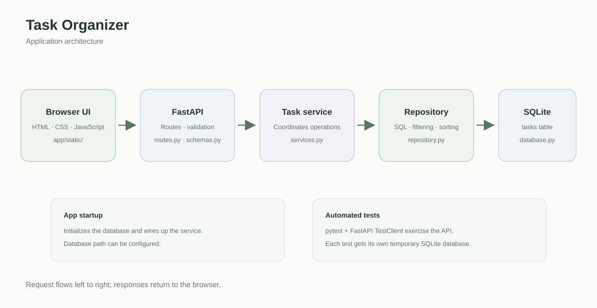

# Task Organizer

A small personal task manager built with FastAPI, SQLite, and vanilla
HTML/CSS/JavaScript. Tasks can be created, edited, completed or reopened, and
deleted. The list can be filtered by completion status and sorted by due date or
priority.

## Requirements

- Python 3.10 or newer
- pip

## Run locally

From the project root, create and activate a virtual environment, then install
the application dependencies:

```powershell
py -m venv .venv
.\.venv\Scripts\Activate.ps1
python -m pip install -r requirements.txt
```

Start the development server:

```powershell
python -m uvicorn app.main:app --reload
```

Open <http://127.0.0.1:8000/> in a browser. FastAPI's interactive API
documentation is available at <http://127.0.0.1:8000/docs>.

The SQLite database is created automatically at `app/data/tasks.sqlite3` the
first time the application starts. Set `TASK_ORGANIZER_DB_PATH` to use another
database file. For example, in PowerShell:

```powershell
$env:TASK_ORGANIZER_DB_PATH = "C:\data\tasks.sqlite3"
python -m uvicorn app.main:app --reload
```

## Run tests

Install the development dependencies and run pytest:

```powershell
python -m pip install -r requirements-dev.txt
python -m pytest
```

Each API test uses its own temporary SQLite database. Tests do not contact an
external service.

## Simplified App Architecture


## Project notes

- `SPEC.md` contains the project specification.
- `API_CONTRACT.md` documents request, response, filtering, sorting, and error
  behavior.
- `AGENT_WORKFLOW.md` records the development prompts, decisions, corrections,
  and lessons learned.
